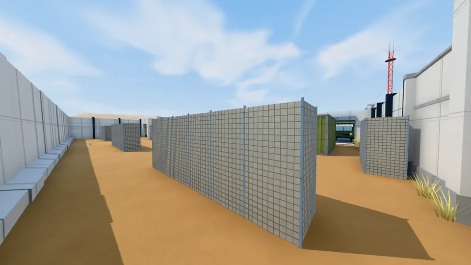
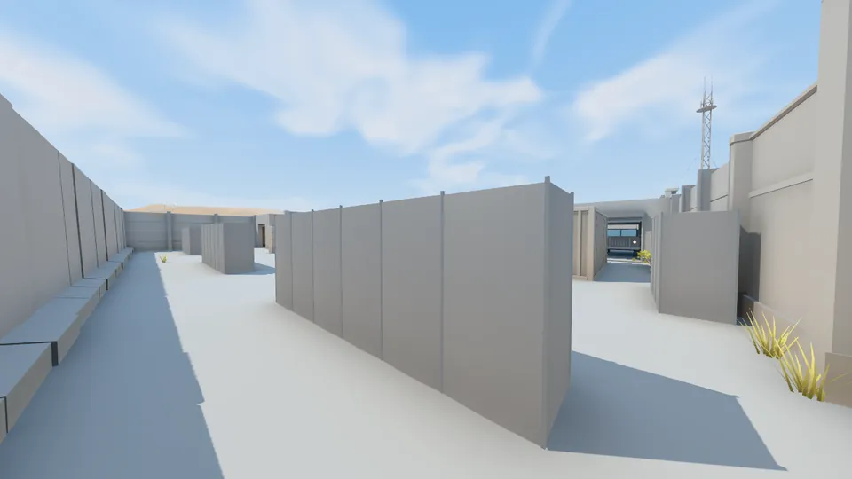
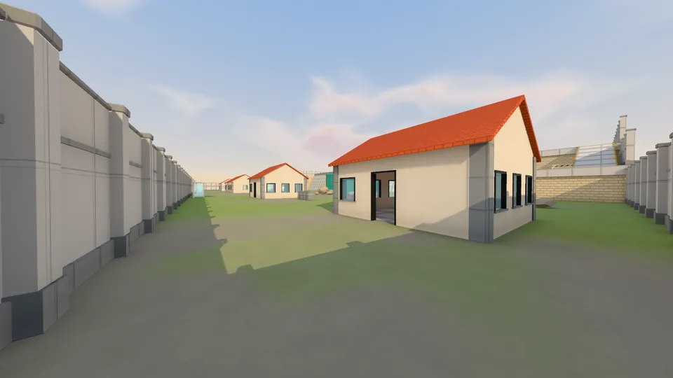
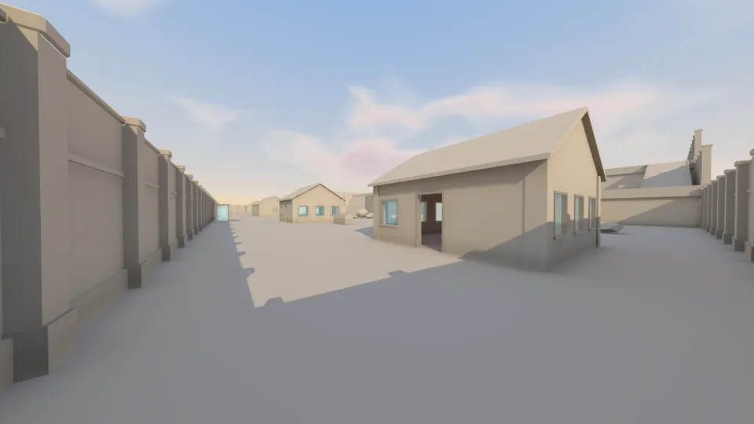
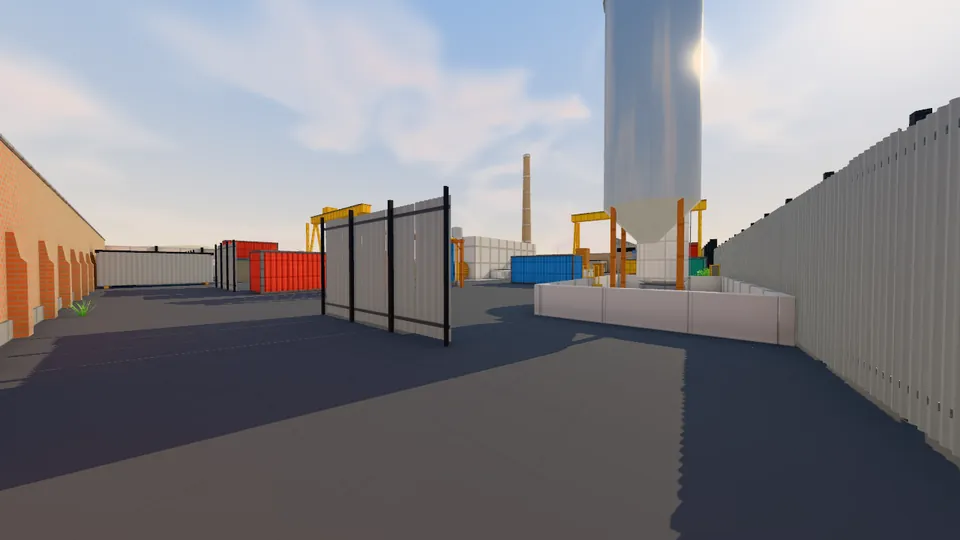
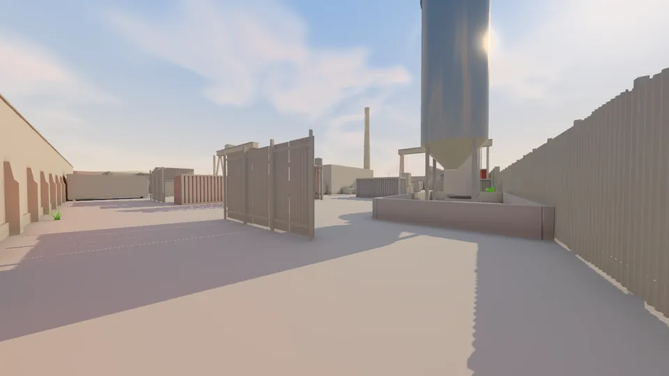

# lightbaker

> **Experimental.** Built for our own browser game (three.js, WebGPU and WebGL) and used there every
> day, but young: the file formats, settings and API may still change without notice. Feel free to
> use it or borrow from it; expect to read the code.

A GPU light baker for games, independent of any engine. It reads a neutral scene (triangles,
materials, a sun and a sky) and writes what a renderer needs to light it:

- a **lightmap atlas**: the sun's shadow as a **signed distance field** (sharp edges at a low texel
  density, so static geometry can leave the cascaded shadow maps), ambient occlusion, and light
  **bounced** between surfaces and from the sky (colour bleeding, several bounces);
- each chart's projection into the atlas (an affine map per chart, the chart of each triangle): the
  engine computes lightmap UVs from its own vertices, nothing per vertex ships;
- an **irradiance volume** (L1 spherical harmonics and sun visibility on a grid) for moving objects.

Rays run in WGSL compute shaders (`wgpu`: Vulkan, DX12, Metal) over a BVH built on the CPU; no
hardware ray tracing needed. The ground plan is cut into **tiles**, each cached by the hash of
everything that can light it, so a change only rebakes the tiles it reaches.

| Lit | Lighting only |
|---|---|
|  |  |
|  |  |
|  |  |

*Maps from the game, in three.js with the baked light; right, the same with every surface grey.*

## Use

```
cargo run --release -p lightbaker-cli -- scene.lbscene --out baked/ --cache .lbcache/
```

- `js/`: a dependency-free TypeScript package to write scenes and read bakes (UVs, the volume, a
  BC5 decoder for GPUs without it). It works with three.js but does not depend on it.
- [docs/FORMAT.md](docs/FORMAT.md): the scene and bake files.
- [docs/DESIGN.md](docs/DESIGN.md): how it bakes, and the engines it learns from.

A bake on a desktop GPU takes seconds per map (an RTX 2060: about ten seconds for a 100 x 100 m map,
three bounces); unchanged tiles are read back from the cache.

MIT licence.
